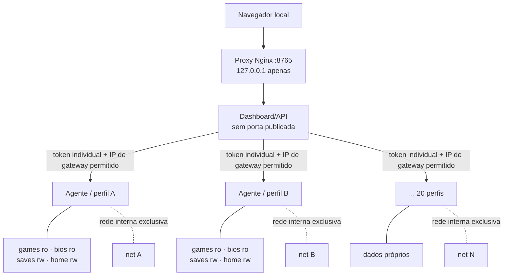

# 🎮 EmuStack

**Fase 1 — implementação Docker-first preparada para aceitação posterior:** builds de cinco perfis, pacotes versionados com assets, importação por SHA-256, rollback, inspeção de dependências e logs, purge explícito de pacotes órfãos, e critérios de aceitação nos agentes. Guia: [Fase 1](docs/PHASE1_IMPLEMENTATION.md). Status de instalação não significa execução aprovada.

<p align="center">
  <strong>Um painel local para organizar, isolar e auditar ambientes de emulação no Linux.</strong><br>
  Um perfil por sistema · dados separados · execução verificável · sem ROMs distribuídas
</p>

<p align="center">
  <a href="https://github.com/joao-henrike/EmuStack/actions/workflows/ci.yml"></a>
  <a href="LICENSE"></a>
  
  
  
</p>

> [!IMPORTANT]
> **20 perfis não significam 20 consoles integralmente emulados.** Um perfil listado pode não ter um binário instalável para Linux, pode depender de arquivos de sistema do usuário ou pode estar deliberadamente bloqueado. EmuStack separa perfis, dados e controle; ele não cria compatibilidade que o emulador upstream ainda não possui.

**EmuStack** é um painel de controle local com agentes isolados por perfil. O objetivo é tornar mais seguros e auditáveis a descoberta de binários, a organização de bibliotecas, a configuração, o armazenamento, os diagnósticos e a aceitação de runtime. A interface não imita o XMB, o Home Menu nem outros sistemas originais em HTML: quando há uma rota real, ela chama o emulador e depende do seu comportamento verdadeiro.

## 📦 Códigos-fonte oficiais gerenciados

O EmuStack agora mantém **24 referências Git fixadas** para os projetos que cobrem os **18 perfis com emuladores** (incluindo os sete módulos oficiais de Mupen64Plus); Xbox One e Xbox Series continuam sem runner suportado. As fontes aparecem em `third_party/` após uma sincronização explícita. **São submódulos, não cópias completas incluídas no histórico do EmuStack;** o build de binários permanece independente.

```bash
python3 scripts/upstream-manager.py audit
python3 scripts/upstream-manager.py sync --jobs 4
python3 scripts/upstream-manager.py audit --require-checkout
```

Para atualizar commits com revisão e sem alterar silenciosamente todos os módulos, veja o [guia de códigos-fonte upstream](docs/UPSTREAM_SOURCES.md).

## 🐳 Docker-first: host mínimo, engenharia padronizada

**Princípio do projeto:** dashboard, agentes, emuladores, ferramentas de build, Qt, SDL e testes executam dentro de containers. O host mantém Docker/Compose, driver da GPU/sessão gráfica/áudio e as interfaces de hardware inevitáveis. O novo `scripts/phase1.sh` executa validação, status, dependências e builds dos **cinco perfis** dentro do mesmo builder Trixie, sem instalar toolchains no host:

```bash
bash scripts/phase1.sh validate
bash scripts/phase1.sh deps melonds
bash scripts/phase1.sh build melonds --yes-run-upstream-code --jobs 2
```

Outros scripts de bootstrap ainda dependem do Python do host; a migração total do bootstrap não foi declarada concluída. Ver [arquitetura Docker-first e dívida técnica](docs/DOCKER_FIRST_ARCHITECTURE.md).

## 🛠️ Fase 1 — Instalação e rollback por perfil

A imagem Docker continua instalando assets oficiais pelo `release-lock.json` e pacotes APT. Adicionalmente, a **CLI Docker-first de gerenciamento** instala executáveis revisados em `data/environments/<id>/emulators/`, isolados por console, com SHA-256, versões anteriores, rollback e remoção controlada. Cinco receitas de build-fonte opt-in foram integradas: **KytyPS5, shadPS4, PPSSPP, melonDS e bsnes**. A compilação e execução real ainda exigem validação no host; nada é declarado compatível apenas por existir um binário.

```bash
bash scripts/phase1.sh status
bash scripts/phase1.sh deps ppsspp
bash scripts/phase1.sh history ppsspp
```

A instalação e o build são ações explícitas via CLI Docker no terminal do operador, **nunca executadas pelo dashboard**. Não há download de jogos, firmware ou BIOS. Consulte [Gerenciamento de emuladores e builds](docs/EMULATOR_MANAGER.md) antes de usar importação ou compilação.

### Builder isolado para todos os cinco perfis

O host Debian 12 não precisa receber pacotes de outra versão para compilar shadPS4, PPSSPP e KytyPS5. Foi adicionado um builder **opt-in** em Debian 13 Trixie, com CMake mais recente, Qt 6.8 e SDL3, mantendo o código-fonte do host somente leitura e a área `data/` separada. Exemplo: `bash scripts/phase1.sh build shadps4 --yes-run-upstream-code --jobs 2`. Para PPSSPP/KytyPS5, troque o ID. Essa compilação ainda exige avaliação no runtime, especialmente recursos/Qt do Kyty. [Procedimento e segurança](docs/EMULATOR_MANAGER.md).

### Fase 1 — Aceitação parcial no Debian (31/10/2026)

O operador compilou e instalou **bsnes** no mount privado do perfil, com SHA-256 registrado; `runtime_tested` continua falso. Os submódulos internos de KytyPS5 (14), shadPS4 (54) e PPSSPP (28) foram sincronizados no Debian. Na tentativa seguinte, KytyPS5/shadPS4 consultaram o SHA errado do EmuStack para prebuilds de FFmpeg (staging Git corrigido), PPSSPP exigiu SDL3/SDL3_ttf (receita corrigida), e melonDS permaneceu sem Qt6 de desenvolvimento (o APT foi executado apenas em modo simulado). Para os três primeiros, use a inspeção `plan-deps` e a sincronização explícita `sync-deps`; para melonDS instale Qt6 do **mesmo Debian do host** e repita `deps`. O guia completo está em [Gerenciador da Fase 1](docs/EMULATOR_MANAGER.md). Nenhuma falha de instalação é tratada como prova de incompatibilidade do console.

## ✨ Visão geral

| Área | O que oferece |
|---|---|
| 🧭 **Dashboard local** | Estado dos serviços, catálogo, biblioteca, sessões, logs e pré-requisitos declarados. |
| 🧱 **20 agentes de perfil** | Um serviço/controlador por ID de ambiente, com token e rede próprios. |
| 📁 **Dados separados** | Raízes exclusivas para jogos, BIOS, saves, HOME e overrides de emuladores. |
| 🛡️ **Defesas em camadas** | Rede interna por agente, mounts limitados, caminhos validados, contêiner endurecido e dashboard ligado ao loopback. |
| 🔎 **Relatórios** | Inventário do host, disponibilidade de assets e aceitação de runtime. |
| 💾 **Storage** | Inspeção, snapshots com manifesto/SHA-256, restauração com rollback e criação de discos de dados vazios. |
| 🧩 **Matriz honesta** | Separa perfil listado, asset fixado, binário disponível, suporte upstream e boot real. |
| 🧰 **Fontes de conteúdo** | Descoberta de lojas, homebrew e demos publicados pelos autores; sem downloader de jogos comerciais. |

## 🚀 Início rápido

**Plataforma de referência:** Linux x86-64, Docker Engine e plugin Docker Compose v2. Display, áudio, NVIDIA/Vulkan e controle dependem do host e são opcionais.

```bash
git clone https://github.com/joao-henrike/EmuStack.git
cd EmuStack
python3 scripts/host-doctor.py
./scripts/host-setup.sh
./scripts/validate-project.sh
./scripts/build-and-audit.sh
./scripts/runtime-acceptance.sh
```

Abra **http://127.0.0.1:8765** no navegador da própria máquina. O dashboard não foi projetado para exposição pela rede local ou pela Internet.

> [!CAUTION]
> Não publique o arquivo `.env`: ele contém tokens individuais dos agentes. Não versione nem compartilhe BIOS, firmware, chaves, NAND, MLC, HDDs, saves ou outros dados pessoais/proprietários. O projeto não inclui esses arquivos.

📘 **Primeira instalação detalhada:** [Guia de instalação](docs/INSTALLATION.md) · **Opções de configuração:** [CONFIGURATION.md](docs/CONFIGURATION.md) · **Aceitação no host:** [LOCAL_ACCEPTANCE.md](docs/LOCAL_ACCEPTANCE.md).

## 🗂️ Perfis e maturidade

A tabela abaixo é um mapa rápido, não um certificado de compatibilidade. A disponibilidade final deve ser confirmada em `install-report.json` e nos estados exibidos pelo dashboard.

| ID | Sistema | Intenção do perfil | Situação do sistema original |
|---|---|---|---|
| `kytyps5` | PlayStation 5 | Projeto experimental / compilação opcional | 🚫 Não suportado |
| `shadps4` | PlayStation 4 | Jogos compatíveis, experimentais | 🚫 Sem boot integral declarado |
| `rpcs3` | PlayStation 3 | Jogos e rota condicional VSH/XMB | 🧪 Depende de firmware e teste real |
| `duckstation` | PlayStation 1 | Jogos e rota condicional de BIOS | 🧪 Depende de BIOS e binário |
| `pcsx2` | PlayStation 2 | Jogos e Browser/Configuration do BIOS | 🧪 Condicional |
| `ppsspp` | PSP | Jogos; VSH/XMB experimental | 🧪 Experimental e dependente de firmware |
| `vita3k` | PlayStation Vita | Jogos/homebrew compatíveis | ℹ️ Interface Vita3K não é o LiveArea original |
| `xbox-one` | Xbox One | Entrada explícita no catálogo | 🚫 Bloqueado, sem runner completo |
| `xenia-canary` | Xbox 360 | Jogos conforme upstream/runner | 🚫 Dashboard retail não suportado |
| `xbox-series` | Xbox Series S/X | Entrada explícita no catálogo | 🚫 Bloqueado, sem runner completo |
| `xemu` | Xbox original | Emulação do hardware, com arquivos do usuário | 🧪 Depende de MCPX/BIOS/HDD; declaração manual não verifica conteúdo |
| `eden` | Nintendo Switch | Jogos experimentais quando há runner compatível | 🚫 HOME Menu completo não suportado |
| `cemu` | Wii U | Jogos e rota condicional para o menu | 🧪 Requer MLC/sistema válidos |
| `dolphin` | Wii / GameCube | Jogos; menu Wii condicionado a NAND | 🧪 Condicional/manual |
| `azahar` | Nintendo 3DS / 2DS | Jogos; configuração manual | 🧪 Manual |
| `melonds` | Nintendo DS | Jogos; firmware/menu condicionado à configuração | 🧪 Manual/condicional |
| `mgba` | Game Boy / Color / Advance | Jogos | ℹ️ Não há dashboard moderno equivalente |
| `mupen64plus` | Nintendo 64 | Jogos | ℹ️ Não há dashboard moderno equivalente |
| `bsnes` | Super Nintendo | Jogos | ℹ️ Não há dashboard moderno equivalente |
| `mesen` | NES e sistemas clássicos compatíveis | Jogos | ℹ️ Não há dashboard moderno equivalente |

### 🔐 O que o release lock significa

O arquivo `release-lock.json` atual é estrito e abrange os 20 IDs: **11 assets oficiais têm hash SHA-256 fixado** e **9 entradas usam `skip-upstream` com motivo declarado**. Isso fixa assets baixáveis observados no build — não significa que 20 emuladores foram instalados, que todos têm suporte Linux, nem que qualquer jogo/firmware inicializa. A compilação opcional de KytyPS5 não está coberta por esse lock. Leia [Builds e reprodutibilidade](docs/BUILD_REPRODUCIBILITY.md).

## 🧱 Arquitetura em uma olhada



O navegador entra por um proxy Nginx mínimo fixado por digest e publicado somente em `127.0.0.1:8765`. O dashboard permanece sem porta publicada e conectado apenas às bridges internas dos agentes e a uma rede backend interna exclusiva do proxy. O proxy não compartilha redes com os agentes e preserva `Host`, `Origin` e `X-EmuStack-Request`; a origem confiável é o IP TCP fixo do proxy, não headers encaminhados.

Cada agente compartilha o kernel Linux do host e a imagem de programas do runtime; **não** é uma VM independente. O dashboard é um orquestrador privilegiado, não deve ser exposto remotamente. Leia o [modelo de segurança](docs/SECURITY.md) e a [arquitetura detalhada](docs/ARCHITECTURE-AND-TESTS.md).

## 📚 Documentação completa

| Guia | Para que serve |
|---|---|
| 🧭 [Índice da documentação](docs/INDEX.md) | Navegação por objetivo, do primeiro uso à engenharia. |
| 🛠️ [Instalação](docs/INSTALLATION.md) | Pré-requisitos, setup, build, gráficos, áudio e controle. |
| ⚙️ [Configuração](docs/CONFIGURATION.md) | Variáveis, limites de recursos, modos de build e sinalizadores de aceitação. |
| 🎮 [Guia do usuário](docs/USER_GUIDE.md) | Painel, biblioteca, jogos, sistemas originais e sessões. |
| 🧩 [Matriz de emuladores](docs/EMULATOR_MATRIX.md) | 20 perfis, limites e estados de confiança. |
| 🧱 [Arquitetura e testes](docs/ARCHITECTURE-AND-TESTS.md) | Componentes, fluxos, verificações e limites dos testes. |
| 🔒 [Ambientes isolados](docs/ISOLATED_ENVIRONMENTS.md) | Rede, mounts, tokens, diretórios e contenção. |
| 🛡️ [Segurança](docs/SECURITY.md) | Modelo de ameaça, defaults, riscos e práticas seguras. |
| ✅ [Aceitação local](docs/LOCAL_ACCEPTANCE.md) | Testes no host e critérios para aprovação. |
| 🖥️ [Menus originais](docs/ORIGINAL_SYSTEM_UI.md) | Pré-requisitos e limites do boot de sistema/menu real. |
| 📦 [Build e reprodutibilidade](docs/BUILD_REPRODUCIBILITY.md) | Imagem base, APT, release lock e atualização de hashes. |
| 🔄 [Releases e atualizações](docs/RELEASE_AND_UPDATES.md) | Atualizar assets com revisão e rastreabilidade. |
| 🕹️ [Fontes de jogos](docs/GAME_SOURCES.md) | Lojas, homebrew, demos e orientação de direitos. |
| 🧰 [Solução de problemas](docs/TROUBLESHOOTING.md) | Diagnóstico por sintoma. |
| 🔌 [Referência de API e CLI](docs/API_REFERENCE.md) | Endpoints internos, payloads, autenticação e comandos. |
| 🧑‍💻 [Desenvolvimento](docs/DEVELOPMENT.md) | Contribuir, validar e manter a integridade dos manifestos. |
| 📝 [Changelog](CHANGELOG.md) | Histórico das mudanças. |

## ✅ Validação: o que cada camada prova

| Camada | Evidência que pode fornecer | O que não prova |
|---|---|---|
| Testes de unidade | Lógica, validações e regressões cobertas pelos testes | Compose real, drivers, GUI ou boot de jogo |
| CI/Compose | Parsing de manifests, build da imagem no runner e probes automatizados executados | GPU física, desktop, áudio, controle físico ou desempenho no seu host |
| Runtime acceptance no host | Serviços, topologia, mounts, controle do dashboard e capacidades opcionais detectáveis | Compatibilidade de todos os títulos ou autenticidade de todos os arquivos de sistema |
| Teste manual por perfil | Evidência direta para a máquina, binário, arquivos e jogo testados | Compatibilidade universal em outros hosts e versões |

O pipeline e os resultados recentes ficam em [GitHub Actions](https://github.com/joao-henrike/EmuStack/actions). Confira o estado do commit que pretende usar; badges e relatórios são dinâmicos.

## ⚖️ Conteúdo, direitos e licenças

- EmuStack não instala nem distribui ROMs, BIOS, firmware, chaves, NAND, MLC, discos de sistema ou jogos comerciais.
- A lista de fontes é um índice de descoberta; ela não garante a licença, formato ou compatibilidade de cada item.
- Obter um jogo numa loja não significa que a loja forneça uma ROM/ISO utilizável por um emulador.
- A licença MIT deste repositório cobre as integrações de EmuStack; cada emulador e dependência mantém sua própria licença.

## 🤝 Contribuições

Leia [Desenvolvimento](docs/DEVELOPMENT.md), faça mudanças em uma branch, execute `./scripts/validate-project.sh` e abra um Pull Request. Melhorias na documentação são bem-vindas, especialmente quando separam comportamento observado de expectativa.

---

<p align="center"><sub>EmuStack · documentação orientada à evidência · não distribui conteúdo de console protegido</sub></p>
