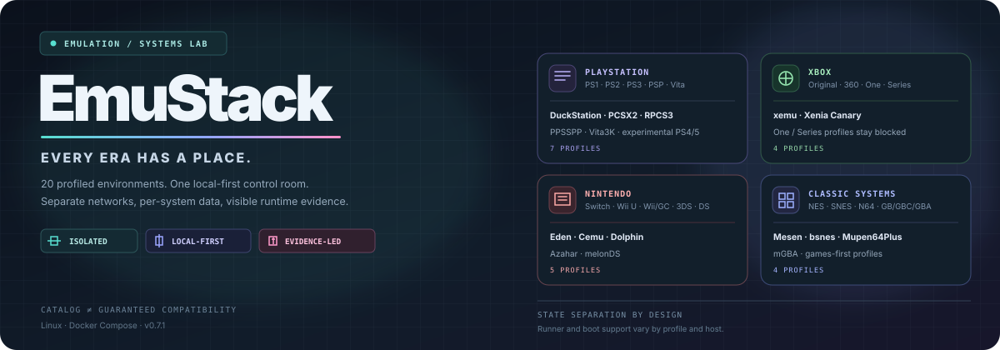
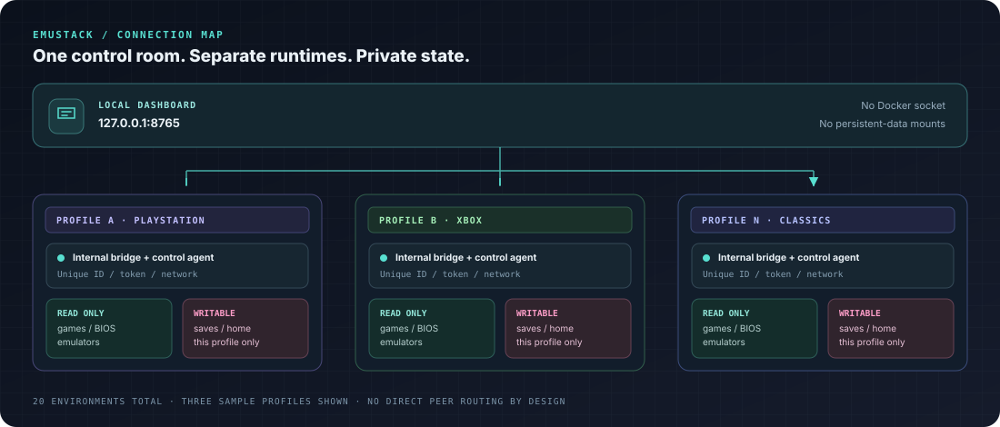

  

  
  
  
  

  <strong>Várias gerações de jogos. Um laboratório local. Vinte perfis separados.</strong> 
  Uma camada de orquestração para emuladores — não um emulador universal nem uma promessa de compatibilidade.

  <a href="#-comece-aqui">Começar</a> ·
  <a href="#-escolha-sua-era">Catálogo</a> ·
  <a href="#-como-o-emustack-funciona">Arquitetura</a> ·
  <a href="#-documentação-de-campo">Documentação</a> ·
  <a href="docs/ROADMAP-STATUS.md">Roadmap</a>

---

## 🎮 O que é o EmuStack?

O EmuStack organiza **20 perfis de ambientes de emulação** numa interface local. Cada perfil recebe um agente de controle, uma rede interna própria e diretórios persistentes separados. O painel reúne o catálogo, a descoberta de launchers, a biblioteca local, os logs, os diagnósticos e os fluxos condicionais de inicialização de sistemas.

A ideia central é simples: **cada sistema tem seu próprio slot**. Jogos e arquivos de sistema não ficam misturados numa pasta global; um agente não recebe acesso genérico ao shell; e o painel não se apresenta como o dashboard original de nenhum console.

### O que ele faz

| Sistema | O que oferece |
|---|---|
| 🕹️ **Orquestração local** | Um dashboard em <code>127.0.0.1:8765</code> para consultar os perfis e as sessões. |
| 🧩 **Ambientes separados** | 20 agentes, redes internas independentes e raízes de dados por perfil. |
| 💾 **Persistência auditável** | Inventário, backup/restore com manifesto e SHA-256, além de criação de discos de dados vazios. |
| 🔎 **Diagnóstico com evidência** | Inventário de host, relatório de instalação, verificações de Compose e probes opcionais de runtime. |
| 🛡️ **Defaults defensivos** | Tokens distintos por agente, dashboard ligado ao loopback, mounts mínimos e sem socket Docker nos serviços da aplicação. |
| 📚 **Descoberta responsável** | Fontes oficiais e homebrew/demos, com orientação por perfil e avisos de direitos/compatibilidade. |

### O que ele não promete

- **20 perfis não significam 20 emuladores instalados.** Confira <code>install-report.json</code> após o build.
- **Agente online não significa jogo funcional.** São camadas diferentes de validação.
- **Uma rota de boot não comprova um boot real.** Firmware, configurações, runner e host podem impedir a inicialização.
- **Não há build bit-a-bit garantido** em toda arquitetura ou ambiente, mesmo com hashes upstream fixados.
- Xbox One e Xbox Series permanecem perfis bloqueados, sem runner completo suportado.
- O projeto não baixa nem distribui ROMs, jogos comerciais, BIOS, firmware, chaves, NAND ou HDDs proprietários.

## 🚀 Comece aqui

### Requisitos

- Linux; o ambiente principal documentado é Debian 13.
- Docker Engine e Docker Compose v2 funcionais para o usuário que executará o projeto.
- Espaço em disco para a imagem, o cache do build e os jogos/arquivos de sistema fornecidos pelo usuário.
- Uma sessão X11/XWayland se você precisar de janelas gráficas. NVIDIA, áudio e controles são integrações opcionais do host.

### Instalação inicial

No clone do repositório:

<pre><code>chmod +x scripts/host-setup.sh scripts/validate-project.sh scripts/build-and-audit.sh scripts/runtime-acceptance.sh
./scripts/host-setup.sh
./scripts/validate-project.sh
./scripts/build-and-audit.sh</code></pre>

Quando o build concluir, abra <strong><a href="http://127.0.0.1:8765">http://127.0.0.1:8765</a></strong>.

O <code>host-setup.sh</code> cria as pastas por perfil e gera tokens locais distintos no arquivo <code>.env</code>. **Não publique nem compartilhe esse arquivo.** O endereço de loopback é intencional: o dashboard não foi projetado para ser exposto diretamente à LAN ou à internet.

### GPU NVIDIA (opcional)

Depois de configurar e testar o NVIDIA Container Toolkit no host:

<pre><code>USE_NVIDIA=1 ./scripts/build-and-audit.sh
USE_NVIDIA=1 ./scripts/runtime-acceptance.sh</code></pre>

Esses comandos não instalam drivers no host nem certificam Vulkan, áudio, controles, um emulador específico ou a compatibilidade de um jogo. Consulte o relatório de aceitação e os logs reais.

### Primeiro diagnóstico

<pre><code>python3 scripts/host-doctor.py
python3 scripts/host-doctor.py --write
docker compose ps
docker compose logs --tail=200 dashboard</code></pre>

A opção <code>--write</code> salva dados locais de hardware/host em <code>data/host-capabilities.json</code>; revise o conteúdo antes de compartilhá-lo.

## 🗂️ Escolha sua era

O catálogo está organizado por famílias. Os nomes abaixo são **IDs de perfil** usados em <code>environments.json</code>, no Compose e nos diretórios de dados.

| Coleção | Perfis | Sistemas associados | Estado em uma frase |
|---|---|---|---|
| **PlayStation** | <code>duckstation</code>, <code>pcsx2</code>, <code>rpcs3</code>, <code>ppsspp</code>, <code>vita3k</code>, <code>shadps4</code>, <code>kytyps5</code> | PS1, PS2, PS3, PSP, PS Vita, PS4, PS5 | Runner, firmware e rotas de sistema variam: PS4/PS5 são experimentais e não há promessa de dashboard completo. |
| **Xbox** | <code>xemu</code>, <code>xenia-canary</code>, <code>xbox-one</code>, <code>xbox-series</code> | Xbox original, Xbox 360, Xbox One, Xbox Series S/X | xemu/Xenia dependem de runner e configuração; One/Series ficam bloqueados sem runner completo. |
| **Nintendo** | <code>dolphin</code>, <code>cemu</code>, <code>azahar</code>, <code>melonds</code>, <code>eden</code> | Wii/GameCube, Wii U, 3DS/2DS, DS, Switch | Jogos e menus exigem configurações diferentes; HOME Menu completo não é prometido em todos os perfis. |
| **Clássicos** | <code>mesen</code>, <code>bsnes</code>, <code>mupen64plus</code>, <code>mgba</code> | NES e clássicos, SNES, Nintendo 64, GB/GBC/GBA | Perfis voltados a jogos; não existe dashboard moderno equivalente para esses sistemas. |

### Uma nota sobre os “sistemas originais”

A aba **Sistemas originais** tenta executar rotas específicas quando existem pré-requisitos, firmware e runner compatíveis. Alguns exemplos são o shell de BIOS do DuckStation, o Browser do PCSX2, VSH/XMB do RPCS3, a rota experimental do PPSSPP e menus condicionais do Dolphin/Cemu.

Isso não transforma todos os perfis em consoles totalmente emulados. O estado do código, os pré-requisitos detectados, a tentativa de boot, o boot observado e o smoke test são conceitos distintos. Consulte [Matriz de emuladores](docs/EMULATOR_MATRIX.md) e [Sistemas originais](docs/ORIGINAL_SYSTEM_UI.md) para a matriz detalhada.

## 🧱 Como o EmuStack funciona

  

Cada ambiente tem seus próprios diretórios <code>games/</code>, <code>bios/</code>, <code>saves/</code>, <code>home/</code> e <code>emulators/</code>. Os jogos, BIOS e emuladores fornecidos pelo usuário são montados como somente leitura; saves e HOME persistente são graváveis pelo próprio agente. A topologia é baseada em contêineres Linux — **não** são 20 kernels ou máquinas virtuais completos.

Os limites de CPU/memória são tetos, não reservas. Por padrão, o EmuStack permite no máximo dois ambientes ativos ao mesmo tempo para reduzir a pressão sobre a máquina.

## 💾 Saves, snapshots e discos de dados

Inspecione as raízes por ambiente:

<pre><code>python3 scripts/manage-storage.py init
python3 scripts/manage-storage.py inspect
python3 scripts/manage-storage.py inspect rpcs3</code></pre>

Faça backup e restaure com o ambiente parado:

<pre><code>python3 scripts/manage-storage.py backup rpcs3
python3 scripts/manage-storage.py restore rpcs3 backups/rpcs3/ARQUIVO.tar.gz</code></pre>

O restore confere manifesto e hashes, recusa caminhos/symlinks inseguros e mantém rollback antes de substituir a raiz atual. O projeto não presume que todos os emuladores escrevam seus saves na mesma pasta: algumas configurações ficam no <code>home/</code> de cada perfil.

Para criar um disco de dados **vazio**:

<pre><code>python3 scripts/manage-storage.py create-disk xemu --size 8G --format qcow2</code></pre>

É necessário ter <code>qemu-img</code> no host. O arquivo criado não possui sistema operacional, partições ou dashboard de console.

## 🧪 Validação: da configuração ao jogo real

<pre><code>./scripts/validate-project.sh
./scripts/build-and-audit.sh
./scripts/runtime-acceptance.sh</code></pre>

Essas etapas têm objetivos diferentes:

1. **Validação do projeto:** testes e verificações estáticas definidos pelo repositório.
2. **Build e auditoria:** constrói a imagem, aplica verificações de configuração e gera relatório de instalação.
3. **Runtime acceptance:** testa a topologia e os recursos opcionais detectáveis no host real.

O acceptance não é benchmark nem suíte de compatibilidade de jogos. O teste real de jogo/firmware deve ser registrado separadamente por perfil. Execute o acceptance sem sessões de jogo ativas; a rotina de recuperação opt-in pode reiniciar um agente em condições controladas e deve ser tratada como um teste operacional.

Para tornar vídeo, áudio, Vulkan e GPU requisitos obrigatórios:

<pre><code>EMUSTACK_REQUIRE_GUI=1 EMUSTACK_REQUIRE_AUDIO=1 EMUSTACK_REQUIRE_VULKAN=1 EMUSTACK_REQUIRE_GPU=1 ./scripts/runtime-acceptance.sh</code></pre>

Os resultados locais ficam em <code>data/runtime-acceptance.json</code>. Revise os relatórios antes de publicá-los, porque diagnósticos do host podem conter detalhes da máquina.

## 🎮 Jogos e conteúdo autorizado

O EmuStack **não é um site de ROMs e não baixa jogos automaticamente**. A aba Fontes de jogos agrega lojas oficiais, homebrew, demos e documentação de direitos. A presença de uma fonte é um ponto de descoberta, não uma garantia de que cada arquivo seja legal em todo contexto, compatível com o emulador ou distribuído no formato certo.

- Não misture jogos de sistemas diferentes numa pasta global.
- Use conteúdos que você tenha direito de utilizar e arquivos de sistema obtidos por meios legítimos.
- Confira a licença, o formato e os requisitos de cada publicação.

Mais detalhes: [Fontes de jogos e conteúdo autorizado](docs/GAME_SOURCES.md).

## 📁 Mapa do projeto

<pre><code>EmuStack/
├── README.md                    # Visão geral e entrada no projeto
├── assets/                      # Arte vetorial e diagramas da documentação
├── catalog.json                 # Catálogo de projetos de emulação
├── environments.json            # Perfis e capacidades declaradas
├── console-systems.json         # Contratos de sistemas/boot
├── game-sources.json            # Fontes autorizadas e orientações
├── release-lock.json            # Hashes de assets upstream
├── compose.yaml                 # Agentes isolados + dashboard
├── compose.nvidia.yaml          # Integração NVIDIA opcional
├── console_agent.py             # Agente de controle por ambiente
├── webapp.py / web/             # Dashboard, estilos e interface
├── scripts/                     # Setup, auditoria, storage e acceptance
├── tests/                       # Testes de regressão
└── docs/                        # Guias operacionais e de engenharia</code></pre>

## 📚 Documentação de campo

| Preciso de… | Leia |
|---|---|
| Instalar e preparar o host | [Guia de instalação](docs/INSTALLATION.md) |
| Operar a interface e adicionar jogos | [Guia do usuário](docs/USER_GUIDE.md) |
| Entender quais perfis realmente existem | [Matriz de emuladores](docs/EMULATOR_MATRIX.md) |
| Entender boot e menus originais | [Sistemas originais](docs/ORIGINAL_SYSTEM_UI.md) |
| Auditar redes, tokens e mounts | [Modelo de segurança](docs/SECURITY.md) |
| Entender isolamento e armazenamento | [Ambientes isolados](docs/ISOLATED_ENVIRONMENTS.md) |
| Executar testes reais no host | [Aceitação local](docs/LOCAL_ACCEPTANCE.md) |
| Investigar erros e logs | [Solução de problemas](docs/TROUBLESHOOTING.md) |
| Ver política de hashes e snapshots | [Reprodutibilidade do build](docs/BUILD_REPRODUCIBILITY.md) |
| Consultar o estado das correções | [Roadmap e status](docs/ROADMAP-STATUS.md) |
| Ver padrões gráficos e editoriais | [Identidade visual](docs/IDENTIDADE-VISUAL.md) |
| Entender a arquitetura e os testes | [Arquitetura e testes](docs/ARCHITECTURE-AND-TESTS.md) |
| Ver as mudanças por versão | [Changelog](CHANGELOG.md) |

## 🛡️ Segurança, privacidade e limites

- O dashboard fica vinculado a <code>127.0.0.1:8765</code>; não o exponha diretamente por reverse proxy.
- Nunca compartilhe <code>.env</code>, tokens, dumps proprietários ou relatórios de host sem revisão.
- Cada agente usa token e rede próprios; não há comunicação direta entre agentes irmãos.
- O projeto não monta o socket Docker nos serviços da aplicação.
- Não compartilhe imagens de BIOS, firmware, NAND, HDD ou jogos proprietários.
- O isolamento por contêiner reduz a superfície de acesso, mas não equivale a máquinas virtuais com kernel independente.

## 🧭 Filosofia do projeto

O EmuStack prefere uma resposta honesta a um indicador verde artificial. Perfis indisponíveis permanecem identificados; hashes são verificados em vez de ignorados; os testes que dependem do hardware ficam separados dos testes unitários; e um menu não é considerado “real” só porque o código tentou abri-lo.

**Explore. Preserve. Verifique. Jogue — com evidência.**

EmuStack 0.7.1 · Gaming Lab / Local-first emulation orchestration

