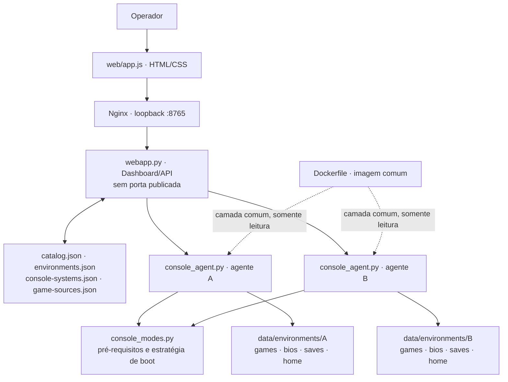

# 🧱 Arquitetura, validação e relatório de testes

**Versão documentada:** EmuStack 0.7.1  
**Relatório atualizado:** 29 de outubro de 2026  
**Evidência CI de referência:** [EmuStack CI — run 40798086510](https://github.com/joao-henrike/EmuStack/actions/runs/40798086510)

> [!IMPORTANT]
> A CI acima passou pelo pipeline automatizado, incluindo build da imagem, inicialização do runtime isolado, testes de fronteira entre agentes e contratos da UI. Isso é evidência válida para aquele commit e ambiente CI; não certifica todos os jogos, firmwares, GPUs, controles ou desktops físicos.

## 🎯 Objetivo arquitetural

EmuStack separa um **plano de controle** — proxy local, dashboard e CLI — de **20 agentes de perfil**. O navegador acessa `127.0.0.1:8765` pelo proxy Nginx; o dashboard não publica uma porta no host. O dashboard lista capacidades e encaminha solicitações validadas. Ele não monta os diretórios persistentes de jogos/BIOS/HOME dos consoles nem o socket Docker. Cada agente usa sua própria raiz de dados e uma rede interna exclusiva.

O projeto também descreve **21 entradas de sistema/menu**. Essa contagem é o número de estratégias documentadas, não a quantidade de boot menus comprovados.

## 🗺️ Visão lógica



A imagem de runtime contém os programas que foram obtidos/instalados durante o build e é comum aos perfis. Os dados persistentes de cada agente não são compartilhados por volume gravável entre perfis. Overrides específicos podem residir em `data/environments/<id>/emulators/`, mas precisam ser executáveis reconhecidos pelo catálogo e compatíveis com a estratégia configurada.

## 🧭 Componentes e fontes de verdade

| Arquivo/componente | Responsabilidade |
|---|---|
| `web/app.js`, `web/index.html`, `web/styles.css` | Interface do navegador, navegação e chamadas ao dashboard. |
| `webapp.py` | API HTTP local, políticas de origem, orquestração e validação dos pedidos do dashboard. |
| `emustack.py` | CLI, detecção de launchers, diagnóstico, relatório de instalação, lock e tentativas de launch/boot. |
| `console_agent.py` | API interna de cada ambiente, autorização por token e sessões do agente. |
| `console_modes.py` | Estratégias de launch, verificação de pré-requisitos e estados dos sistemas/menu originais. |
| `catalog.json` | IDs de emuladores conhecidos, launchers, metadados e parâmetros aceitos. |
| `environments.json` | IDs dos 20 ambientes, limites e dados de execução por perfil. |
| `console-systems.json` | 21 perfis de sistema/menu e seus pré-requisitos declarados. |
| `game-sources.json` | Fontes de descoberta e orientação por categoria/perfil. |
| `release-lock.json` | Asset upstream, versão/referência, SHA-256 e motivos `skip-upstream`. |
| `compose.yaml` | Serviços, redes, IPAM, mounts, portas e limites do runtime. |
| `compose.nvidia.yaml` | Override explícito para conceder GPU NVIDIA aos agentes. |
| `scripts/` | Setup do host, validação, build, aceitação de runtime, storage e atestação do xemu. |
| `tests/` | Testes de lógica, regressão, contratos e segurança. |
| `.github/workflows/ci.yml` | Validação automatizada, build da imagem, runtime acceptance e checks de UI. |
| `.github/workflows/freeze-release-lock.yml` | Workflow manual de descoberta/validação dos assets e geração de artifact de lock. |

Os manifests são interdependentes. Ao adicionar ou remover um perfil, atualize catálogo, ambiente, sistemas, Compose/IPAM/allowlist, testes, documentação e critérios do CI.

## 🔐 Fluxo de controle e segurança

1. O navegador acessa o dashboard local em `http://127.0.0.1:8765`.
2. A API valida rotas, IDs, estrutura do payload, origem e parâmetros do launch.
3. O dashboard solicita operações ao agente associado ao ID, usando seu token individual.
4. O agente autentica `X-EmuStack-Agent-Token`, confere a associação do sistema ao ambiente e rejeita paths inválidos.
5. No Compose principal, cada bridge de agente usa IPAM estático: gateway `.1`, agente `.2` e dashboard `.3`; os gateways esperados formam a allowlist de origem do dashboard. Uma bridge interna adicional liga apenas dashboard (`172.29.0.3`) e proxy (`172.29.0.2`).
6. O proxy possui uma rede de publicação não interna separada, sem agentes ou dashboard; só ele publica `127.0.0.1:8765`. A aceitação inspeciona `NetworkSettings.Ports` para confirmar que a publicação está ativa.
7. Probes do runtime tentam requisições não autorizadas a partir dos agentes e verificam a resposta esperada.

`Host`, `Origin` e `X-EmuStack-Request` são checks complementares, **não a fronteira de confiança sozinhos**. A identidade TCP e os tokens fazem parte do controle. O dashboard é logicamente privilegiado porque coordena os agentes e guarda os tokens; mantenha-o local.

### Isolamento de dados

| Raiz por perfil | Uso | Contrato esperado no agente |
|---|---|---|
| `games/` | Conteúdo a iniciar | Somente leitura. |
| `bios/` | BIOS/boot files do usuário | Somente leitura. |
| `saves/` | Saves, quando o emulador usa esse destino | Gravável. |
| `home/` | Configuração e estado persistente do emulador | Gravável. |
| `emulators/` | Overrides locais de launcher reconhecido | Restrito ao perfil, sem compartilhamento entre IDs. |

Cada contêiner compartilha o kernel do host e a imagem-base comum. Esse modelo **não** equivale a 20 VMs independentes. Recursos opcionais de display, áudio, GPU e controle ampliam a superfície de ataque e dependem das permissões configuradas no host. Veja [Segurança](SECURITY.md) e [Ambientes isolados](ISOLATED_ENVIRONMENTS.md).

## 🧪 Camadas de validação

### 1. Testes automatizados do projeto

```bash
./scripts/validate-project.sh
```

O script executa testes Python via `unittest`, compilação sintática Python, validação do release lock, checagens e testes JavaScript quando Node.js está disponível e sintaxe dos scripts shell. Se Node.js não estiver instalado, os testes JS correspondentes ficam ignorados, não aprovados.

### 2. Configuração Compose e build

```bash
docker compose -f compose.yaml config --quiet
./scripts/build-and-audit.sh
```

O build valida a configuração Compose, tenta compilar a imagem e registra os assets efetivamente obtidos. Requer daemon Docker disponível; downloads upstream dependem da conectividade e da disponibilidade das fontes.

### 3. Aceitação de runtime

```bash
./scripts/runtime-acceptance.sh
```

O teste exige um Docker daemon acessível e uma stack preparada. Inspeciona saúde dos serviços, topologia, IPAM, mounts, flags de hardening, endpoints e tentativas de chamadas protegidas. Pode testar probes opcionais de display, áudio, Vulkan/GPU e um dispositivo de controle explicitamente mapeado. As variáveis `EMUSTACK_REQUIRE_GUI`, `EMUSTACK_REQUIRE_AUDIO`, `EMUSTACK_REQUIRE_VULKAN`, `EMUSTACK_REQUIRE_GPU` e `EMUSTACK_REQUIRE_INPUT` tornam as categorias correspondentes requisitos, quando configuradas para a integração pretendida. Leia [Aceitação local](LOCAL_ACCEPTANCE.md).

### 4. Teste manual por host, sistema e jogo

Precisa de uma máquina-alvo, display/driver/áudio/controle quando aplicáveis, launcher instalado, arquivos de sistema válidos e título legalmente obtido. Deve ser executado separadamente por sistema/jogo. Um probe de GPU não garante que cada emulador use o backend desejado; arquivo presente não prova que BIOS/firmware seja válido; uma estratégia de launch não prova boot visual.

## 📋 Resultados de validação remota verificados

O workflow **EmuStack CI** do commit `07e57c816da7742a8c3b071b6c7e7c825a111f5a` terminou com sucesso em [40798086510](https://github.com/joao-henrike/EmuStack/actions/runs/40798086510).

| Etapa do CI | Resultado observado |
|---|---|
| Testes de código e sintaxe Python/JavaScript/shell | ✅ Passou |
| Validação do release lock estrito | ✅ Passou |
| Parsing dos manifests Compose e correspondência dos IDs | ✅ Passou; 20 IDs de catálogo e ambiente |
| Setup de runtime e validação da configuração Compose mesclada | ✅ Passou |
| Build da imagem sem downloads upstream opcionais | ✅ Passou |
| Inicialização de agentes e dashboard | ✅ Passou |
| Runtime acceptance e probes de fronteira entre agentes | ✅ Passou |
| Cleanup dos serviços após a aceitação | ✅ Passou |
| Contratos dos assets da UI no navegador | ✅ Passou |

Os relatórios de engenharia anteriores também registram 79 testes Python, 13 testes JavaScript de recomendações de lançamento e 11 assertions estáticas da UI. Os totais dependem da revisão/escopo dos testes, portanto consulte o log do run vinculado antes de usar o número em release notes.

**Limite da execução:** o build de CI desliga downloads upstream opcionais. O resultado não prova que cada binário possível esteja instalado e nem executa todos os jogos ou firmwares. A configuração de CI também não representa sua GPU, desktop, áudio ou controle físico.

## 📊 Matriz de evidência

| Área | Evidência mínima | O que ela não prova |
|---|---|---|
| Manifestos | JSON válido, IDs únicos e referências coerentes | Runner instalado ou jogo compatível. |
| Testes unitários | Casos cobertos pela suíte da revisão | Rede/mounts reais ou hardware físico. |
| Build Docker | Imagem construída no ambiente registrado | Todos os assets upstream disponíveis nem desempenho. |
| Isolamento em runtime | IPAM, mounts, hardening e probes aprovados no host/CI testado | Fronteira equivalente a VM ou proteção de host já comprometido. |
| Display/áudio/Vulkan/input | Probe específico aprovado no host testado | Configuração ideal de todos os emuladores ou funcionamento de cada título. |
| Sistema/menu original | Boot visual observado e registrado para a combinação testada | Boot universal em outros hosts, versões ou arquivos. |
| Jogo | Evidência de início/jogabilidade, entrada, áudio e save/load para o título testado | Compatibilidade de toda a biblioteca. |

## 📁 Relatórios e privacidade

O build pode produzir `install-report.json`; os scripts de diagnóstico/aceitação podem gerar `data/host-capabilities.json` e `data/runtime-acceptance.json`. Esses artefatos podem conter arquitetura, GPU, caminhos locais e detalhes do host.

Antes de compartilhar:
- revise e sanitize caminhos pessoais e metadados do host;
- **nunca** anexe `.env`, tokens, firmware, BIOS, jogos, chaves, NAND/MLC/HDD ou saves;
- indique commit, comando, host/arquitetura, código de saída e as verificações realmente executadas;
- separe explicitamente os testes ainda não realizados.

## 🧭 Próxima validação no host-alvo

```bash
python3 scripts/host-doctor.py
./scripts/host-setup.sh
./scripts/validate-project.sh
./scripts/build-and-audit.sh
./scripts/runtime-acceptance.sh
```

Para NVIDIA e probes obrigatórios de hardware, configure o NVIDIA Container Toolkit e aplique os sinalizadores descritos em [Instalação](INSTALLATION.md) e [Aceitação local](LOCAL_ACCEPTANCE.md). Em seguida, teste cada sistema/jogo que pretende usar. Não declare um boot concluído até que a janela real e o comportamento esperado tenham sido observados.
